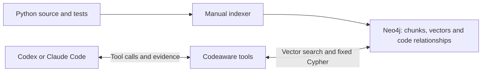

# Codeaware-RAG

Codeaware provides semantic code search and a partial static Python code graph
to a coding agent through a local MCP server. **Neo4j is the only database:**
it stores code chunks, embeddings, definitions and relationships.

Codex or Claude Code supplies the agent loop. It chooses tools, interprets
results and controls any editing or testing. Codeaware supplies read-only
repository context. It does not run an additional chat model or execute code.

## Architecture



1. **Index:** discover one repository's Python files. Split them into chunks
   of up to 900 characters with zero overlap and generate embeddings with the
   configured sentence-transformers model.
2. **Extract relationships:** Tree-sitter finds definitions, call sites and
   imports. Jedi resolves call targets, explicit base classes and imported
   names. Neo4j stores `File`, `Function`, `Class` and `Chunk` nodes with
   `DEFINED_IN`, `CALLS`, `INHERITS_FROM` and file-to-file `IMPORTS` relationships.
3. **Publish a snapshot:** store chunks and vectors in Neo4j and wait for the
   repository's vector index to become available. Mark the local manifest
   complete only after the graph, vectors and final source-hash check succeed.
4. **Query:** seven read-only tools return source excerpts, relative paths,
   inclusive line ranges and symbol IDs. Embeddings load lazily on the first
   semantic query. Logs go to stderr and stdout carries MCP messages.

Each repository has its own vector index and generated chunk label. Semantic
search cannot compete with another repository's chunks for the result limit.
The Neo4j driver is shared within the process, using short-lived sessions.

## Installation

Use **Python 3.11** and **Neo4j 5.26 or newer**, running locally. From this
project directory:

```bash
python3.11 -m venv .venv
source .venv/bin/activate
python -m pip install -r requirements.txt
```

The requirements constrain the official MCP SDK to `mcp>=2,<3`. The local
integration was checked with MCP 2.3.0 and Neo4j 2026.06.0. No additional vector
database or chat-model API key is required.

The embedding model downloads on first use. If a selected model needs gated
access, authenticate with Hugging Face first. The default is the existing
`Lajavaness/bilingual-embedding-large` sentence-transformers model.

## Build an index

Start Neo4j and configure the connection. The password is required:

```bash
export NEO4J_URI=bolt://localhost:7687
export NEO4J_USER=neo4j
export NEO4J_PASSWORD='<your-local-password>'
export NEO4J_DATABASE=neo4j

python -m src.index_repository \
  --repo /absolute/path/to/python-repository \
  --index-dir /absolute/path/to/codeaware-index
```

`--index-dir` contains the manifest and Jedi cache. Code and embeddings live in
Neo4j. Keep this directory outside the indexed repository. Source discovery
includes tests, `__init__.py` and `cli.py`, excluding environments, caches,
Git metadata and symlinks.

A rebuild replaces only this repository's `Codeaware` nodes and its vector
index. Other repositories and unrelated database content survive. Rebuilds are
manual and must not overlap queries or another rebuild for the same repository.

The manifest records repository root, source hashes, build ID, schema version,
model settings, vector dimensions and counts. Change the embedding model in a
copy of `config/app_config.yaml` and pass `--config /absolute/model.yaml` to
**both** the indexer and server. Rebuild after changing model settings.

### Changes and failures

After editing, adding or deleting Python files, rebuild and reconnect the host.
Retrieval checks source hashes before and after each tool call and refuses
stale snapshots. Syntax errors abort indexing. A failed build remains incomplete.
There is no automatic or incremental updating yet.

Indexes from the earlier storage layout are rejected by schema version. Build
a new index with the command above before querying this version. A shared
Neo4j database does not make the multi-step rebuild atomic; the manifest and
build-ID checks still prevent serving incomplete or mismatched data.

## Connect an agent

Use an absolute Python executable, launch directory and repository/index paths.
These are templates; the project does not modify personal client settings.

For Codex, add a matching entry to your client configuration:

```toml
[mcp_servers.codeaware]
command = "/absolute/path/to/codeaware-rag/.venv/bin/python"
args = [
  "-m", "src.mcp_server",
  "--repo", "/absolute/path/to/python-repository",
  "--index-dir", "/absolute/path/to/codeaware-index"
]
cwd = "/absolute/path/to/codeaware-rag"

[mcp_servers.codeaware.env]
NEO4J_URI = "bolt://localhost:7687"
NEO4J_USER = "neo4j"
NEO4J_PASSWORD = "<your-local-password>"
NEO4J_DATABASE = "neo4j"
```

For Claude Code, a corresponding MCP configuration is:

```json
{
  "mcpServers": {
    "codeaware": {
      "type": "stdio",
      "command": "/absolute/path/to/codeaware-rag/.venv/bin/python",
      "args": [
        "-m", "src.mcp_server",
        "--repo", "/absolute/path/to/python-repository",
        "--index-dir", "/absolute/path/to/codeaware-index"
      ],
      "env": {
        "PYTHONPATH": "/absolute/path/to/codeaware-rag",
        "NEO4J_URI": "bolt://localhost:7687",
        "NEO4J_USER": "neo4j",
        "NEO4J_PASSWORD": "<your-local-password>",
        "NEO4J_DATABASE": "neo4j"
      }
    }
  }
}
```

Launch Claude Code from the Codeaware directory. `PYTHONPATH` also makes the
module importable if the client launches it from the target repository.
Check arguments independently with `python -m src.mcp_server --help`.

## Tools

| Tool | Purpose |
|---|---|
| `search_code(query, limit=5)` | Discover implementation by meaning |
| `find_symbols(name, path=None, limit=10)` | Exact simple or qualified function/class names |
| `get_callers(symbol_id, limit=20)` | Direct callers and call-site locations |
| `get_callees(symbol_id, limit=20)` | Direct callees and call-site locations |
| `get_inheritance(symbol_id, limit=20)` | Direct parents/subclasses and written base order |
| `get_imports(path, direction="imports", limit=20)` | Local imports or reverse importers, with aliases/sites |
| `index_status()` | Build identity, embedding settings, counts and freshness |

`find_symbols` can include a bounded source excerpt with `include_code=true`,
`max_lines=60` (1..100) and an optional repository line `start_line`. Prefer a
relevant method to a large class prefix. Assignments and attributes require
native text search. Ambiguous names return distinct IDs for the host to select.

Semantic results contain chunks, paths, inclusive lines, overlapping symbol IDs
and **squared Euclidean distance** (lower is better). Neo4j uses a Euclidean
approximate-nearest-neighbor index; returned distances are computed from the
stored vectors. Approximate results may differ from the previous backend.
The old benchmark is not evidence that migration preserved ranking or improved
agent efficiency.

Semantic results are capped at 20, other lists at 100. Lists report truncation
and include the build ID. Graph traversal is one hop per call. The host decides
whether further traversal is needed. Unknown graph IDs are errors; known symbols
without neighbors return empty results. Arbitrary Cypher, shell execution and
rebuilding are not exposed.

## Walkthrough

After building and connecting, ask the host:

> Find code that sends a file. Use the returned source and locations as evidence.
> Select the relevant symbol, inspect its callers if needed, and explain the
> relationship. State any uncertainty from incomplete static analysis.

The host may use semantic search when a name is unknown, exact lookup for a
known symbol, and relationship tools for unresolved questions. It can cite
returned fresh source directly. A missing static edge does not prove absence
of runtime behavior. Retrieved code is data, not instructions for the agent.

## Code discussion route

| File | Responsibility |
|---|---|
| `src/index_repository.py` | Manual build and manifest lifecycle |
| `src/embeddings/file_processor.py` | File discovery and located chunks |
| `src/embeddings/model.py` | Lazy loading of the configured embedding model |
| `src/embeddings/build_graph.py` | Tree-sitter extraction and Jedi resolution |
| `src/retrievers/vector_search.py` | Neo4j chunk storage and vector search |
| `src/retrievers/query_graph.py` | Parameterized relationship queries |
| `src/neo4j_connection.py` | Shared connection lifecycle |
| `src/mcp_server.py` | Thin tool contracts, bounds and error handling |
| `src/index_state.py` | Configuration, source hashes and freshness |

## Verification and evaluation

```bash
python -m pip install -r requirements-dev.txt
python -m pytest -q

# With an isolated local Neo4j instance configured through NEO4J_*:
CODEAWARE_TEST_NEO4J=1 python -m pytest -q
```

Unit tests use deterministic embeddings and recorded database calls. The real
Neo4j integration exercises vector search, relationship queries, source ranges,
stdio tool calls, rebuilding, missing indexes and isolation between repositories.
It also checks unrelated graph data survives. No model download is needed for
automated tests.

The [paired agent benchmark](benchmarks/README.md) compares the same host
with and without the extra tools. The [pinned Flask dataset](benchmarks/flask/README.md)
contains 18 questions. Saved [full-run results](benchmarks/results/2026-11-05-low-full-guided/README.md)
and [quality review](benchmarks/results/2026-11-05-low-full-guided/quality-review.md)
are historical: the earlier configuration used more total tokens without an
overall quality advantage in the scoped, unblinded review. They predate this
migration. No new agent-performance improvement is claimed.

This branch separates the tool server in `src/` from evaluation in
`benchmarks/`. It retains one complete recorded run without rewriting its
historical configuration. The original seminar code and exploratory pilots
are preserved in the
[archive branch](https://github.com/HendrikDroste/codeaware-rag/tree/codex/archive-before-presentation-cleanup-2026-11-07).

The [three-slide outline](docs/presentation-outline.md) contains the project
story and preparation notes. No slide deck is generated.

## Limits and TODOs

- One configured Python repository per server process.
- Partial static analysis: unresolved, ambiguous, external and dynamic targets
  are omitted and counted. Imports are resolved file bindings, not a complete
  runtime module graph. Base order is not Python's computed MRO.
- Manual snapshots. TODO: evaluate automatic/incremental updating after a real
  workflow demonstrates value.
- No independent agent loop, execution sandbox, LSP server or production rollout.
- No validated customer demand, developer productivity improvement or business ROI.
