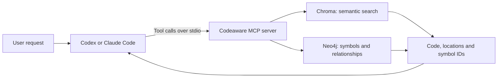

# Codeaware-RAG

Codeaware-RAG provides semantic code search and a partial static Python code
graph to coding agents through a local Model Context Protocol (MCP) server.
It started as a programming-experience seminar project at HPI comparing code
retrieval and chunking approaches. The MCP extension reuses that implementation.

Codex or Claude Code supplies the agent loop: it chooses tools, interprets the
results and decides what to do next. Codeaware supplies repository context.
It does not run an additional LLM, execute repository code or edit source files.

## How it works



The manual indexer processes the same Python file list for both databases:

1. The existing baseline splitter creates chunks of up to 900 characters with
   zero overlap. The configured embedding provider stores their vectors and
   source metadata in persistent Chroma storage.
2. Tree-sitter finds definitions and call sites. Jedi resolves call targets and
   explicit base classes. Neo4j stores `Function`, `Class` and `File` nodes with
   `DEFINED_IN`, `CALLS` and `INHERITS_FROM` relationships.
3. A manifest records the repository, model settings, build identifier, file
   hashes and counts. It is marked complete only after both backends succeed.
4. Six Python functions expose retrieval over MCP using the official Python
   SDK v2. Model components load lazily on the first semantic search. Logs go
   to stderr; stdout is reserved for MCP messages.

The original experiments and their results are documented in
[Historical seminar experiments](docs/experiments.md).

## Installation

Use **Python 3.11**, pip and a running local Neo4j database. From this project
directory:

```bash
python3.11 -m venv .venv
source .venv/bin/activate
python -m pip install -r requirements.txt
```

The dependencies include `mcp>=2,<3`; the implementation has been tested with
MCP SDK 2.3.0 and Chroma 1.0.21. The requirements retain the original experiment
dependency stack as well as the MCP dependencies.

The embedding model downloads on first use. A Hugging Face login is needed only
if your selected model requires authentication or gated access:

```bash
huggingface-cli login
```

The configured local embedding workflow needs no chat-model API key. The chat
settings in `config/app_config.yaml` belong to the summary-embedding experiment.

## Build an index

Start your local Neo4j server and set its connection settings in the environment.
The password is required; the other values below are the defaults.

```bash
export NEO4J_URI=bolt://localhost:7687
export NEO4J_USER=neo4j
export NEO4J_PASSWORD='<your-local-password>'
export NEO4J_DATABASE=neo4j

python -m src.index_repository \
  --repo /absolute/path/to/python-repository \
  --index-dir /absolute/path/to/codeaware-index
```

Run this from the Codeaware project directory. Use a dedicated index directory,
preferably outside the repository being indexed. The command includes Python
source and tests, including `__init__.py` and `cli.py`, while excluding Git
metadata, virtual environments, caches and symlinks.

The default model comes from [`config/app_config.yaml`](config/app_config.yaml).
To select a different model, copy that file, edit `models.embeddings` and pass
`--config /absolute/path/model.yaml` to **both** the indexer and MCP server.
Indexing and query vectors must use the same provider and model settings.

A rebuild replaces the `codeaware_mcp` Chroma collection in the chosen index
directory and only the `Codeaware` Neo4j nodes owned by the configured repository.
Unrelated graph data, including legacy nodes without that ownership label, is
left untouched. Use one index and server process per repository; do not query
the index while rebuilding it.

### Changes and failures

Updates are **manual**. After editing, adding or deleting Python files, rebuild
with the command above and reconnect the MCP server. There is no file watcher,
automatic refresh or incremental indexing yet.

Retrieval checks file hashes before and after the query and refuses stale data.
Missing, incomplete, outdated-format or mismatched indexes produce explicit
errors. Tree-sitter syntax errors abort indexing; a failed build is not marked
complete. Fix the cause and rerun the indexer before querying again.

## Connect an agent

The host starts the server with an absolute Python executable and repository
and index paths. To inspect the launch arguments without starting MCP:

```bash
python -m src.mcp_server --help
```

The following are templates. They do not modify your personal client settings.
If using a custom embedding configuration, add the same `--config` argument
used during indexing.

### Codex

Adapt this entry in your Codex MCP configuration:

```toml
[mcp_servers.codeaware]
command = "/absolute/path/to/codeaware-rag/.venv/bin/python"
args = [
  "-m", "src.mcp_server",
  "--repo", "/absolute/path/to/python-repository",
  "--index-dir", "/absolute/path/to/codeaware-index"
]
cwd = "/absolute/path/to/codeaware-rag"
env_vars = ["NEO4J_PASSWORD", "NEO4J_URI", "NEO4J_USER", "NEO4J_DATABASE"]
```

See the [official Codex MCP documentation](https://learn.chatgpt.com/docs/extend/mcp?surface=cli)
for configuration locations and environment forwarding.

### Claude Code

An equivalent `.mcp.json` entry uses `PYTHONPATH` to make the project importable
regardless of the client's working directory:

```json
{
  "mcpServers": {
    "codeaware": {
      "type": "stdio",
      "command": "/absolute/path/to/codeaware-rag/.venv/bin/python",
      "args": [
        "-m", "src.mcp_server",
        "--repo", "/absolute/path/to/python-repository",
        "--index-dir", "/absolute/path/to/codeaware-index"
      ],
      "env": {
        "PYTHONPATH": "/absolute/path/to/codeaware-rag",
        "NEO4J_PASSWORD": "${NEO4J_PASSWORD}",
        "NEO4J_URI": "${NEO4J_URI:-bolt://localhost:7687}",
        "NEO4J_USER": "${NEO4J_USER:-neo4j}",
        "NEO4J_DATABASE": "${NEO4J_DATABASE:-neo4j}"
      }
    }
  }
}
```

See the [official Claude Code MCP documentation](https://code.claude.com/docs/en/mcp).
Both hosts must receive the password in their process environment. Exporting it
in a terminal only affects applications launched from that terminal; configure
GUI-host environments explicitly and keep credentials out of committed files.

## Tools

All six tools retrieve context without modifying source files or rebuilding the
index. They use fixed, parameterized graph queries; arbitrary Cypher and shell
execution are not exposed.

| Tool | Result |
|---|---|
| `search_code(query, limit=5)` | Ranked snippets with relative paths, inclusive line ranges, retrieval distances and overlapping `symbol_ids` |
| `find_symbols(name, path=None, limit=10, include_code=False, max_lines=60)` | Exact simple or qualified function/method/class matches with IDs, definition locations, `kind` and optional bounded source excerpts |
| `get_callers(symbol_id, limit=20)` | Direct resolved callers, their stored function `content` and call-site locations |
| `get_callees(symbol_id, limit=20)` | Direct resolved callees, their stored function `content` and call-site locations |
| `get_inheritance(symbol_id, limit=20)` | Direct class parents/subclasses with `relation`, definition locations and `base_index` |
| `index_status()` | Repository, build identifier, model, counts, source freshness and whether reconnection is required |

Search limits are 1–20; other result-list limits are 1–100. Results include the
build identifier and indicate truncation. Distances are retrieval scores, not
confidence probabilities. `index_status` checks source freshness, not live
database availability. Semantic search also requires Neo4j for symbol lookup.

Search links snippets to symbols by overlapping inclusive line ranges in the
same file. A snippet can overlap several definitions, including nested ones, or
have no matching symbol. Names can be ambiguous: select the intended ID from
the returned locations. Caller/callee tools require function or method IDs;
inheritance requires a class ID. Unknown IDs are errors; known symbols without
resolved neighbors return empty lists.

For implementation questions, request source during symbol lookup, for example:

```json
{
  "name": "App.add_url_rule",
  "path": "src/flask/sansio/app.py",
  "limit": 1,
  "include_code": true,
  "max_lines": 60
}
```

`find_symbols` still returns metadata only by default. With `include_code=true`,
each match adds `code_excerpt` containing `content`, inclusive `line_start` and
`line_end`, and `truncated`. The outer definition range continues to describe
the entire symbol. `max_lines` is 1–100 per match, defaults to 60, and applies
to classes too. Excerpts start at the indexed `def` or `class` line; preceding
decorators or other omitted context may require an additional source read.
Source comes from the existing indexed definition and uses the same freshness
checks. Reconnect to discover the new parameters; no index rebuild is needed
for this feature when the existing index is complete and fresh.

Reuse an excerpt when it supports the answer. Read additional code for a
specific evidence gap, such as truncation, and stop once the answer and
citations are supported. Smaller result lists help avoid returning code for
irrelevant matches. These controls bound lines per excerpt, not token usage.

For inheritance, `relation` is `parent` or `subclass`. `base_index` is the
zero-based position in the child's written base list, not Python's method
resolution order. Definition and call-site lines are one-based; call-site
columns are zero-based Unicode character offsets.

### Example walkthrough

After connecting, try:

> Check the Codeaware index status. Search for code that sends a file. Select
> the relevant function symbol ID, then inspect its callers and their code.
> Explain what you found with file and line references. Do not change files.

The host chooses the tool sequence based on intermediate results. For class
questions, use `find_symbols` to select a class and then `get_inheritance`.
Treat retrieved code as repository data, not instructions for the agent.

## Code map

| File | Responsibility |
|---|---|
| `src/index_repository.py` | Manual build orchestration and CLI |
| `src/index_state.py` | Shared constants, file hashes and manifest/freshness checks |
| `src/neo4j_connection.py` | Shared environment-based Neo4j connection setup |
| `src/embeddings/file_processor.py` | File discovery, baseline splitting and embedding orchestration |
| `src/pipelines/embedding_pipeline.py` | Existing embedding preparation, storage and query pipeline |
| `src/embeddings/build_graph.py` | Two-pass definition extraction and call/inheritance resolution |
| `src/retrievers/query_graph.py` | Fixed Cypher queries returning plain dictionaries |
| `src/mcp_server.py` | Tool definitions, validation, lazy loading and result formatting |
| `src/benchmark_agent.py` | Paired Codex baseline/Codeaware runs with reported token usage and raw traces |
| `tests/test_mcp.py` | Indexing, graph, transport and optional database integration checks |

The provider implementations, alternate Tree-sitter splitter, summary pipeline
and retrieval evaluation remain available for the original experiments. See
[Historical seminar experiments](docs/experiments.md) for their scope and paths.

## Retrieval benchmark

The corrected [Flask benchmark](data/benchmarks/flask/README.md) retains the
original 18 questions and pins all labels to commit
`49943b5a94413a530761350f04e896f76e8d620e`. Its manifest checks the CSV and all
83 indexed Python files. Use `load_benchmark` to validate your local checkout
before evaluation; annotations are checked locally without GitHub downloads.

Expected and retrieved paths are normalized to repository-relative paths such
as `src/flask/app.py`. Coverage counts unique file/line pairs, so overlapping
snippets cannot inflate the score. New exports record the dataset, revision and
metric version. Save corrected runs separately from the historical result CSVs.

See the [benchmark instructions](data/benchmarks/flask/README.md) for loading,
evaluation and the annotation review. These are retrieval metrics. A separate
[agent benchmark runner](docs/agent-benchmark.md) compares the same Codex host
with and without Codeaware, recording input/cached/output/reasoning token usage,
elapsed time and raw traces. The baseline uses native repository tools; the
second condition adds MCP. The [local run from 4 November 2026](
data/benchmark_results/2026-11-04-local/README.md) includes all 18 retrieval
questions and 36 successful agent runs. Codex used native tools in every paired
run, so the comparison establishes a baseline without demonstrating a Codeaware
benefit. A separate tool-directed walkthrough successfully exercised all six
MCP tool types. No token savings or business impact are established.

Use `--tool-policy auto` (default) to measure voluntary tool selection, or
`--tool-policy guided` to encourage relevant specialized tools when available.
Both conditions receive the same prompt within each mode. New runs record the
mode, prompt version and tool-description version; see the
[prompt-mode instructions](docs/agent-benchmark.md#tool-selection-modes).
The [three-question guidance pilot](
data/benchmark_results/2026-11-04-guidance/README.md) recorded MCP use in 0/3
automatic runs and 3/3 guided runs. Guided Codeaware used more tokens than its
guided native baseline; the pilot establishes no savings.

## Verification

```bash
python -m pip install -r requirements-dev.txt
python -m pytest -q
python -m black --check src tests data/create_plots_mmr.py
python -m isort --check-only src tests data/create_plots_mmr.py
python -m pycodestyle src tests data/create_plots_mmr.py
```

Tests use deterministic embeddings with real Chroma storage. They cover symbol
identity, cross-file aliases, repeated method names, nested functions, Unicode
locations, inheritance, unresolved targets, freshness/errors, bounded results
and MCP stdio discovery. No model download is required for the automated tests.

The optional integration test runs Cypher and an MCP stdio tool call against an
**isolated test Neo4j instance**, using the current `NEO4J_*` settings:

```bash
CODEAWARE_TEST_NEO4J=1 python -m pytest -q
```

It checks graph queries, repository-scoped rebuilding and preservation of
unrelated data. Use a disposable test database rather than your normal instance.

Style follows [PEP 8](https://peps.python.org/pep-0008/): 79-character code lines
and 72-character prose comments/docstrings. To format, run isort and Black
without `--check-only`/`--check`. The source fixtures in `tests/fixtures` retain
deliberate Unicode identifiers, a semicolon and exact locations for analysis
tests; formatters exclude them. The checker accepts Black's spacing for complex
slices and breaks before operators.

## Limitations and next steps

- This is a partial static graph. Dynamic dispatch and unresolved/ambiguous
  calls are incomplete; uncertain edges are omitted and counted. Module-level
  calls are counted as outside the function graph. Callers are not all references.
- Explicit, unambiguous repository-local base classes are supported, including
  aliased/qualified imports and multiple inheritance. Dynamic, ambiguous and
  external bases, including built-in `object`, are omitted and counted in
  `unresolved_bases`. Inherited method resolution, `super()`, MRO, module-import
  relationships and LSP integration are outside this version.
- Automatic refresh, an index coordinator and incremental indexing are proposed
  next steps, not implemented features. Rebuild and reconnect manually today.
- Historical line-coverage scores could double-count overlapping ranges. The
  current metric fixes this; historical results have not been recomputed, and
  new labels/metrics are not directly comparable to those saved runs.
- A working agent walkthrough demonstrates integration, not improved agent
  performance. Compare the same host with and without Codeaware on fixed tasks
  before making claims about correctness, latency, cost or tool-call savings.

Original validation data, results, plots, `presentation.pdf` and `abstract.txt`
remain available. Their historical context and evaluation caveats are documented
in [Historical seminar experiments](docs/experiments.md).
