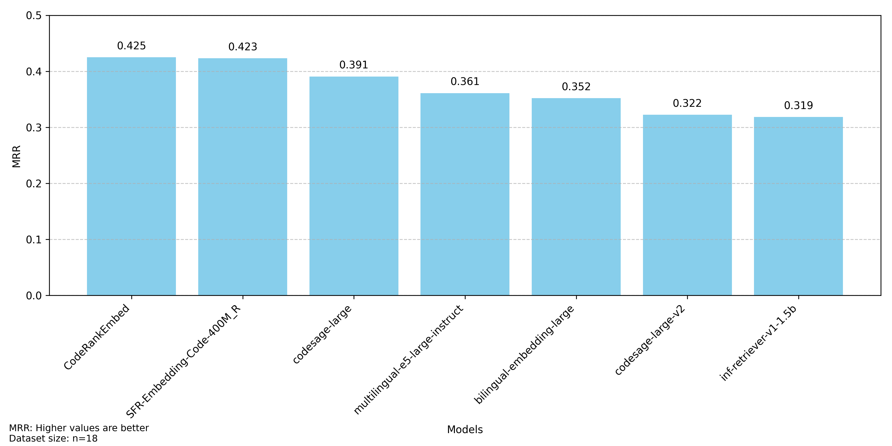
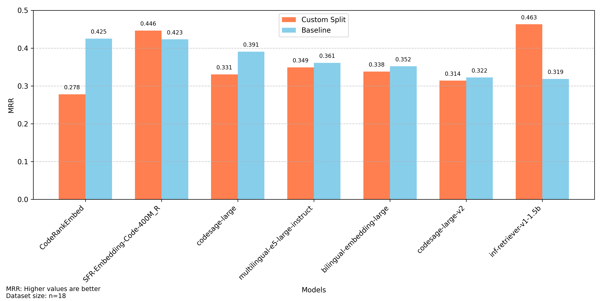
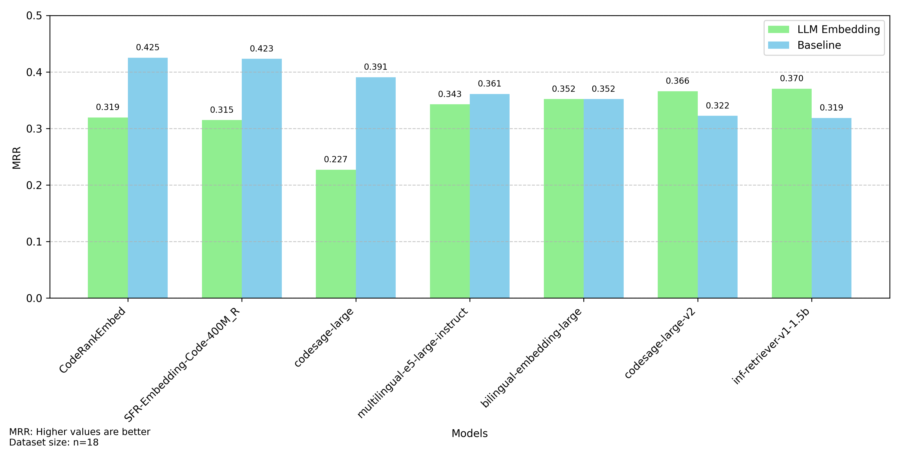

# Historical seminar experiments

These notes describe the original HPI programming-experience seminar experiments.
They are retained as research history. For the current MCP server, installation,
and usage, see the [main README](../README.md).

The saved CSVs, validation questions, plots, [presentation](../presentation.pdf)
and [abstract](../abstract.txt) remain in the repository. They evaluate retrieval
and chunking; they do not establish an improvement in coding-agent performance.
The interpretations below are the original exploratory findings from a small
validation set, not current embedding-model rankings.

The existing line-coverage metric double-counts overlapping retrieved ranges.
Do not use it for new coverage claims until this is fixed. Saved historical
scores have not been recomputed. The summary-embedding plot also differs from
the original presentation because incorrect summary embeddings were fixed
before these saved results were produced, as noted below.

## Running the original experiments

The retained entry points are `src/pipelines/embedding_pipeline.py`,
`src/pipelines/embedding_summary_pipeline.py` and
`src/embeddings/tree_sitter_split.py`. They retain their original experiment
paths and defaults, including skipping `__init__.py` and `cli.py`.

Inspect and adjust the source repository, persistence and validation/output
paths in each module's `__main__` block before running it from the project root,
for example with `python -m src.pipelines.embedding_pipeline`. Some experiments
require a chat model and its provider credentials; the MCP workflow does not.

New experiment pipelines inherit from `BaseRAGPipeline` in
[`src/pipelines/base_pipeline.py`](../src/pipelines/base_pipeline.py).
`EmbeddingPipeline` remains the shared embedding implementation.

The unfinished LLM-generated Cypher pipeline and the old Streamlit UI were
removed from the current branch; their original versions remain in Git history.
The current graph tools use fixed, parameterized Cypher and the host agent.

## Project Decisions
This section documents the key decisions made during project development.

### Datasets
We developed a custom dataset based on the Flask repository because no existing dataset met our requirements.
The closest alternative is the [CodeSearchNet](https://huggingface.co/datasets/sentence-transformers/codesearchnet) dataset, which focuses on finding functions for given comments.
However, this dataset lacks coverage of important concepts like inheritance and function usage patterns.

### Chunking
For chunking Python files, we use the [RecursiveCharacterTextSplitter](https://python.langchain.com/docs/modules/data_connection/document_loaders/text_splitters/character_text_splitter) from LangChain as our baseline.
LangChain is a popular library for building RAG systems and provides a simple interface for splitting text into smaller chunks.

We also implemented a custom splitter (see [Custom Splitter](#results) for details).
Since we do not plan to further develop chunking approaches, we have not included the splitter in our pipelines.
To change the chunking approach, modify the splitter in the `file_processor.py` file.

### Embedding Models
To compare the performance of different retrievers and splitters, we use multiple embedding models.
Our focus was on maintaining implementation simplicity while providing a variety of models for comparison.
We therefore chose the [sentence-transformers](https://www.sbert.net/) library.
Other providers (e.g., OpenAIProvider) are at different stages of development and not yet ready for production use.

> [!TIP]
> You can find a list of current top-performing embedding models on the [HuggingFace MTEB Leaderboard](https://huggingface.co/spaces/mteb/leaderboard).

### Pipelines
To enable rapid prototyping of different retrievers, we adopted a pipeline-based approach.
This architecture allows us to focus on data preparation and retrieval while reusing existing implementations for data loading, chunking, model handling, and evaluation.

Popular approaches like the [EmbeddingPipeline](../src/pipelines/embedding_pipeline.py) can be reused to create custom pipelines, as demonstrated in the [EmbeddingSummaryPipeline](../src/pipelines/embedding_summary_pipeline.py).

### Evaluation
For retriever evaluation, we use the Mean Reciprocal Rank (MRR) metric, where $`Q`$ is the set of questions and $`\text{rank}_i`$ is the rank of the first relevant code chunk for question $`i`$.

```math
\text{MRR} = \frac{1}{|Q|} \sum_{i=1}^{|Q|} \frac{1}{\text{rank}_i}
```

We consider a chunk relevant if at least one of its lines is part of the desired code defined in the dataset.

A significant limitation of the MRR metric is that it only considers the first relevant code chunk found.
This means questions requiring multiple code chunks for complete answers are not evaluated correctly.
We recommend using the MRR metric in combination with other metrics that need to be implemented.

## Results
Experimental results, including validation files, are stored in the `data` directory.
The results currently provide only a rough overview of different retriever performance.
For a comprehensive performance assessment, multiple new metrics need to be implemented (see the [Future Work](#future-work) section).

Note that our embedding model selection was based on small models (< 2 billion parameters) from the [HuggingFace MTEB Leaderboard](https://huggingface.co/spaces/mteb/leaderboard) as of May 2025.
Since models and their capabilities evolve rapidly, these results may not represent the top models from this leaderboard.

### Baseline Results
Baseline results are stored in the `data/results_baseline.csv` file.
The baseline uses the LangChain [RecursiveCharacterTextSplitter](https://python.langchain.com/docs/modules/data_connection/document_loaders/text_splitters/character_text_splitter) and the [EmbeddingPipeline](../src/pipelines/embedding_pipeline.py).
The `RecursiveCharacterTextSplitter` splits code into smaller chunks based on class and function definitions as well as empty lines until reaching the desired chunk size of 900 characters.



The baseline results show that code-specialized models (except `codesage-large-v2`) outperform models fine-tuned on English language.
Even the best-performing models achieve scores below 0.5, indicating significant room for improvement.

### Custom Chunking Results
The custom chunking approach was to use [tree-sitter](https://tree-sitter.github.io/tree-sitter/) to create more meaningful chunks.
Instead of defining a maximum chunk size, we create exactly one chunk for each function and method in the codebase.
This should lead to more meaningful embeddings, as embeddings are created for single functionalities rather than multiple ones.



We observe that the `CodeRankEmbed` and `inf-retriever-v1-1.5b` models are two significant outliers in this chart.
The reasons for this behavior are unclear, as we found no explanations in the respective model papers.
We suspect this is due to our small dataset size.
Our hypothesis that custom chunking leads to better embeddings is therefore not supported by these results.

### Embedding Summary Chunking Results
The embedding summary chunking approach uses an LLM to summarize each code chunk and uses the summary as the embedding.
Since most embedding models are trained on text or code separately and not both, this could potentially lead to better results.
For chunking, we use the `RecursiveCharacterTextSplitter`, as custom chunking did not yield better results.



We observe that results (except for `bilingual-embedding-large` and `inf-retriever-v1-1.5b`) are very similar to baseline results.
Both outliers are again unexplainable by the model papers.
Similar to custom chunking, we suspect the small dataset is responsible for these outliers.

> [!IMPORTANT]
> These results differ from those used in the presentation. Unfortunately, there was a bug that resulted in embedding incorrect summaries. This bug has been fixed and the results have been updated.
